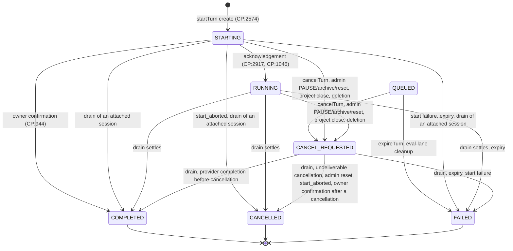

# Soko Bot turn lifecycle

How a `SokoBotTurn` row starts, who may drain it, how it recovers and how it ends. Derived from the code at `0ebc62681`; line numbers refer to that commit. The terminal checkpoint (under the drain fences) is a later change, described by function name, not line. Paths are relative to `apps/core/src/`. Short names:

- **CP**: `services/soko-bot-control-plane.service.ts`
- **WD**: `services/soko-bot-turns-sync.service.ts` (the watchdog, run by `/sync/soko-bot-turns`)
- **AUTH**: `services/soko-bot-runtime/authorization.ts`

A claim marked **(unconfirmed)** could not be confirmed from the code. Tickets 15 and 20 below are local planning notes ("A Soko Bot turn stays STARTING when its recovery worker dies"; "Soko Bot turn lifecycle: pre-existing gaps found in review"), not Sokosumi Tasks.

## The row fields that carry ownership

| Field                     | Meaning                                                                                                                                                                                                                                                                                  |
| ------------------------- | ---------------------------------------------------------------------------------------------------------------------------------------------------------------------------------------------------------------------------------------------------------------------------------------- |
| `status`                  | Active: `QUEUED`, `STARTING`, `RUNNING`, `CANCEL_REQUESTED` (`ACTIVE_TURN_STATUSES`, CP:194). Terminal: `COMPLETED`, `CANCELLED`, `FAILED`. Runtime authorization treats only `STARTING`, `RUNNING` and `CANCEL_REQUESTED` as active (`services/soko-bot-runtime/task-policy.ts:36-40`). |
| `leaseToken`              | The drain authority. Fenced writes compare it. `settleTurn` clears it (CP:1624); the eval-lane cleanup does not (see Exits that bypass `settleTurn`).                                                                                                                                    |
| `leaseExpiresAt`          | Runtime authorization refuses calls once it passes. `settleTurn` clears it (CP:1625).                                                                                                                                                                                                    |
| `reconcilerHeartbeatAt`   | Liveness of whoever drains. Watchdog scans 3 and 4 select on it. `settleTurn` does not write it (CP:1614-1626).                                                                                                                                                                          |
| `eveSessionId`            | The runtime session. Set by acknowledgement (CP:2925, :1054) or by runtime session attach (AUTH:161-176).                                                                                                                                                                                |
| `errorKind`               | `runtime_start_ambiguous` is written by the ambiguous mark (CP:3064), by the recovery claim (CP:1214) and after a retryable recovery error (CP:1231).                                                                                                                                    |
| `deadlineAt`              | Hard end, set once at creation (CP:2397-2404): background run 6 h; otherwise 60 min if `personAsked \|\| input.personStarted`; otherwise 15 min.                                                                                                                                         |
| `eveStreamIndex`          | Drain cursor. The current drain moves it forward only (`advanceCursor`, CP:3202-3206).                                                                                                                                                                                                   |
| `cancellationRequestedAt` | Set with `CANCEL_REQUESTED` by every writer listed under Cancellation, except that admin reset on a row already `CANCEL_REQUESTED` keeps the existing value.                                                                                                                             |
| `runnerDiagnosticAt`      | Claimed at most once by the sandbox failure report that fails the turn (`services/soko-bot-sandbox-turn.service.ts:772-780`).                                                                                                                                                            |

Constants: `TURN_LEASE_MS` 16 min (CP:188, WD:15), `RECONCILER_HEARTBEAT_MS` 15 s (CP:189), `SOKO_BOT_START_RECOVERY_GRACE_MS` 120 s (CP:190), `SOKO_BOT_TURN_STALE_HEARTBEAT_MS` 45 s (WD:16), `SOKO_BOT_TURN_STARTING_GRACE_MS` 30 s (WD:17), watchdog `BATCH_SIZE` 20 candidates per scan (WD:14). The `/sync/soko-bot-turns` cron runs every minute (`apps/core/vercel.json:140-143`).

## States and transitions

Self-transitions are listed in the table, not drawn. The eval-lane cleanup marks every active status `FAILED` (see Exits that bypass `settleTurn`).

### `QUEUED`

The database column defaults to `QUEUED` (`packages/database/prisma/migrations/20260817190000_add_soko_bot_control_plane/migration.sql:110`; Prisma `@default(QUEUED)`). Core's only turn create passes `status: "STARTING"` explicitly (CP:2580); no Core write of `QUEUED` was found.

A `QUEUED` row, legacy or defaulted, is active for Core:

- It can leave through `expireTurn` once due (scan 1, WD:85-96).
- Admin reset can fence it to `CANCEL_REQUESTED` (CP:4440-4464).
- The eval-lane cleanup can fail it.

Runtime authorization refuses it ("Soko Bot turn is not active", AUTH:83-87). `reconcileTurn` throws for it without a session (CP:3114-3116).

### Settlement (`settleTurn`, CP:1472-1796)

Every terminal write except the eval-lane cleanup goes through `settleTurn`. It runs in a serializable transaction:

- **Re-read** (CP:1504-1543): returns `false` if the row is no longer active, or if `input.leaseToken` is given and differs.
- **Billing** (CP:1545-1554): bills from the row's totals. A billing shortfall replaces the error kind with `insufficient_credits` (CP:1583-1588).
- **Cancellation vs. completion** (CP:1576-1582): `COMPLETED` becomes `CANCELLED` when `cancellationRequestedAt` is set and the provider completion time is absent or at/after it. A `CANCEL_REQUESTED` turn therefore settles `COMPLETED` only when the recorded provider completion is strictly earlier than the cancellation.
- **Final CAS** (CP:1607-1626): active status, plus `leaseToken` when given, plus `eveSessionId: null` when `requireMissingEveSession`. It clears `leaseToken` and `leaseExpiresAt`.

### Exits that bypass `settleTurn`

- `prepareEvalLane` (`services/evals/eval-lanes.service.ts:378-388`) updates every `QUEUED`/`STARTING`/`RUNNING`/`CANCEL_REQUESTED` turn of the lane's two bots to `FAILED` `eval_run_stopped`. There is no token check, and `leaseToken`, `leaseExpiresAt` and the heartbeat are left as they were.
- Hard bot deletion (`services/soko-bot-deletion.service.ts:168-176`) marks `STARTING`/`RUNNING` turns `CANCEL_REQUESTED`, then deletes every turn of the bot in the same transaction (`:111`).

### Transitions

| From                                                                                                                      | To                                                                      | Function and line                                                                                                                                                                                                                                         | Lease condition                                                                                                                                                                             |
| ------------------------------------------------------------------------------------------------------------------------- | ----------------------------------------------------------------------- | --------------------------------------------------------------------------------------------------------------------------------------------------------------------------------------------------------------------------------------------------------- | ------------------------------------------------------------------------------------------------------------------------------------------------------------------------------------------- |
| none                                                                                                                      | `STARTING`, session null, heartbeat null                                | `startTurn` serializable create (CP:2574-2649)                                                                                                                                                                                                            | new token; `leaseExpiresAt` and `deadlineAt` sampled at CP:2397-2406, before context building and the create                                                                                |
| `STARTING`                                                                                                                | `RUNNING`, session, heartbeat                                           | `startTurn` acknowledgement (CP:2917-2930)                                                                                                                                                                                                                | CAS `STARTING` + own token; writes heartbeat, not `leaseExpiresAt`                                                                                                                          |
| `STARTING`                                                                                                                | `RUNNING`, `errorKind` cleared                                          | `resumeAmbiguousStart` acknowledgement (CP:1046-1061)                                                                                                                                                                                                     | CAS `STARTING` + the token it was handed                                                                                                                                                    |
| `STARTING`/`RUNNING`, session null                                                                                        | same, session set                                                       | runtime `authorize` session attach (AUTH:127-176)                                                                                                                                                                                                         | no token compare; requires `deadlineAt` and `leaseExpiresAt` > now and an unpaused bot                                                                                                      |
| `STARTING`                                                                                                                | `STARTING`, `runtime_start_ambiguous`, heartbeat null                   | `startTurn` catch (CP:3056-3071)                                                                                                                                                                                                                          | CAS `STARTING` + own token                                                                                                                                                                  |
| `STARTING`, session null                                                                                                  | `STARTING`, new token, heartbeat, `runtime_start_ambiguous`             | `recoverStartingTurn` claim (CP:1198-1217)                                                                                                                                                                                                                | CAS on status, session null, observed token, `leaseExpiresAt`, heartbeat; for unprompted turns also `proactivePaused: false`                                                                |
| `STARTING`                                                                                                                | `STARTING`, heartbeat null, `runtime_start_ambiguous`                   | `recoverStartingTurn` after `SokoBotRetryableStartError` (CP:1226-1234)                                                                                                                                                                                   | CAS `STARTING` + own token (a no-op if either changed)                                                                                                                                      |
| `STARTING`/`CANCEL_REQUESTED`                                                                                             | same; heartbeat and `leaseExpiresAt` refreshed; error and session kept  | `retainStartLease` (CP:669-685), from `startTurn` (CP:3000) and `resumeAmbiguousStart` (CP:1111)                                                                                                                                                          | CAS own token; one write, no timer                                                                                                                                                          |
| `STARTING` at the receipt; `STARTING`, or `CANCEL_REQUESTED` if a cancellation committed after the receipt, at settlement | `COMPLETED` requested; `CANCELLED` when settled from `CANCEL_REQUESTED` | `settleOwnerConfirmation` (CP:829-946), from `startTurn` (CP:2886) and `resumeAmbiguousStart` (CP:960). The receipt transaction requires `STARTING`, own token and `cancellationRequestedAt: null` (CP:893-942) and commits before `settleTurn` (CP:944). | `settleTurn` with own token and no provider time, so a row cancelled in between settles `CANCELLED` (CP:1576-1582); a replaced token makes it return `false`, which is ignored (CP:944-945) |
| `STARTING`/`CANCEL_REQUESTED`                                                                                             | `FAILED` `runtime_start_failed`                                         | `failStartedTurn` (CP:1819-1835), from `startTurn` (CP:3073) and `recoverStartingTurn` (CP:1236)                                                                                                                                                          | `settleTurn` with own token, any active status                                                                                                                                              |
| `STARTING`/`CANCEL_REQUESTED`                                                                                             | `CANCELLED` `start_aborted`                                             | `startTurn` catch after `SokoBotStartAbortedError` (CP:3047-3054)                                                                                                                                                                                         | `settleTurn` with own token                                                                                                                                                                 |
| `CANCEL_REQUESTED`                                                                                                        | same; accepted session, `start_aborted`, heartbeat null                 | `startTurn` catch when the accepted session was not reset (CP:3029-3045)                                                                                                                                                                                  | CAS `CANCEL_REQUESTED` + own token                                                                                                                                                          |
| `STARTING`/`RUNNING`                                                                                                      | `CANCEL_REQUESTED`                                                      | the cancellation writers below                                                                                                                                                                                                                            | none; token unchanged (admin reset excepted)                                                                                                                                                |
| any active foreground                                                                                                     | `CANCEL_REQUESTED`, new token                                           | admin `RESET_SESSION` fence (CP:4440-4464)                                                                                                                                                                                                                | CAS on observed status only                                                                                                                                                                 |
| `CANCEL_REQUESTED` (reset)                                                                                                | `CANCELLED` `session_reset`                                             | admin `RESET_SESSION` (CP:4526-4534)                                                                                                                                                                                                                      | `settleTurn` with the reset token; its result is ignored and `SUCCEEDED` is recorded (CP:4537-4569)                                                                                         |
| `CANCEL_REQUESTED`, session null                                                                                          | `CANCELLED` `cancelled_before_runtime_start`                            | `settleUndeliverableCancellation` (CP:1798-1817)                                                                                                                                                                                                          | returns `false` when the row has no token; otherwise settles under the row's current token with `requireMissingEveSession`                                                                  |
| active with a session (`STARTING` included)                                                                               | terminal                                                                | `reconcileTurn` on `input.requested` (CP:3420-3447), `session.waiting` (CP:3450-3459), `session.completed`/`session.failed` (CP:3461-3477), or on one of them already persisted (terminal checkpoint, below)                                              | `settleTurn` with the drain's token                                                                                                                                                         |
| active                                                                                                                    | same; `runtime_stream_interrupted`; heartbeat now                       | `reconcileTurn` catch before the deadline (CP:3489-3502)                                                                                                                                                                                                  | CAS drain token + active; writes heartbeat only, not `leaseExpiresAt`                                                                                                                       |
| any active                                                                                                                | `FAILED` `turn_deadline_exceeded`                                       | `expireTurn` (CP:1853-1891)                                                                                                                                                                                                                               | none: active status only, `settleTurn` without a token                                                                                                                                      |

`reconcileTurn` does not require `RUNNING`. A `STARTING` row whose session was attached early by the runtime passes CP:3114 and is drained.

### Cancellation

Writers of `CANCEL_REQUESTED` + `cancellationRequestedAt`. None of them changes the token except admin reset, and admin reset on a row already `CANCEL_REQUESTED` keeps its `cancellationRequestedAt`.

| Writer                | Where                                               | Rows                                                                                                                                                                               |
| --------------------- | --------------------------------------------------- | ---------------------------------------------------------------------------------------------------------------------------------------------------------------------------------- |
| `cancelTurn`          | CP:3534-3543                                        | the turn, from `STARTING`/`RUNNING`                                                                                                                                                |
| admin `PAUSE`         | CP:4219-4229                                        | the bot's newest active foreground turn, from `STARTING`/`RUNNING`                                                                                                                 |
| `archive`             | CP:4877-4887                                        | same                                                                                                                                                                               |
| admin `RESET_SESSION` | CP:4440-4464                                        | the newest active foreground turn, any active status; installs a new token; sets `cancellationRequestedAt` unless the observed status is already `CANCEL_REQUESTED` (CP:4458-4461) |
| project close         | `services/project-soko-bots-close.service.ts:21-41` | every `STARTING`/`RUNNING` turn of the project's bots that are not archived or deleted                                                                                             |
| hard deletion         | `services/soko-bot-deletion.service.ts:168-176`     | every `STARTING`/`RUNNING` turn, deleted in the same transaction                                                                                                                   |

Runtime cancellation is delivered only for a bound turn. `deliverRuntimeCancellation` needs both `eveSessionId` and `eveTurnId` (CP:1845). `cancelTurn` (CP:3543), admin `PAUSE` (CP:4252-4254) and `archive` (CP:4913-4916) attempt it once. The drain redelivers it at its start (CP:3306) and right after it binds the runtime turn (CP:3349), only while the row is still `CANCEL_REQUESTED` (CP:3152-3156).

### `expireTurn` callers

- the watchdog's first scan (WD:85-96);
- `reconcileTurn` after a stream error past the deadline (CP:3486-3488);
- a CMO turn with no runtime progress for 5 min (`services/soko-bot-turn-progress.service.ts:13`, `:49-63`), which can expire before the deadline;
- a slow CMO research turn on re-hire (`services/cmo-hiring.service.ts:495-504`);
- CMO eval cleanup (`services/evals/eval-cmo-runner.ts:143`, `:664-679`).

## Who holds the lease, and when it is renewed

| Holder                                    | Gets the token                                               | Renews                                                                                                                                                                                                                                                                               | Ends                                                                                                           |
| ----------------------------------------- | ------------------------------------------------------------ | ------------------------------------------------------------------------------------------------------------------------------------------------------------------------------------------------------------------------------------------------------------------------------------ | -------------------------------------------------------------------------------------------------------------- |
| Fresh starter (`startTurn`)               | row create (CP:2405, :2633)                                  | Not before acknowledgement. Acknowledgement writes the heartbeat only (CP:2928). `retainStartLease` once after an acknowledgement failure (CP:3000).                                                                                                                                 | settles; marks ambiguous (token kept, heartbeat null); or a recovery claim replaces the token                  |
| Recovery claimant (`recoverStartingTurn`) | claim (CP:1190, :1211-1213)                                  | Not before acknowledgement. `retainStartLease` once after an acknowledgement failure (CP:1111).                                                                                                                                                                                      | settles; clears its heartbeat after a retryable error (CP:1227-1234); or the process dies holding it           |
| Drain (`reconcileTurn`)                   | `expectedLeaseToken`, else the row's current token (CP:3118) | `heartbeat()` at start (CP:3305), on a 15 s timer (CP:3296-3302), and as the fence of each projected event write (CP:3270, :3292). Writes heartbeat and `leaseExpiresAt = now + 16 min` (CP:3182-3191), with no expiry predicate, so it also renews an expired lease it still holds. | settlement clears the token; a failed fence throws `SokoBotReconciliationLeaseLostError` (CP:3193-3196, :3481) |
| Watchdog stale claim                      | CAS (WD:198-211)                                             | through the drain it runs (WD:218-222)                                                                                                                                                                                                                                               | as a drain                                                                                                     |
| Admin reset                               | fence (CP:4449-4464)                                         | never                                                                                                                                                                                                                                                                                | its own `settleTurn` (CP:4527)                                                                                 |

Runtime authorization is the only check that rejects on `leaseExpiresAt`. `authorize` (AUTH:31-241) also checks the feature switch and availability (AUTH:36-46), the requested capability (AUTH:106) and workspace access (AUTH:160, :209). Its lifecycle checks:

1. Active status, without `CANCEL_REQUESTED` (AUTH:83-92).
2. An unpaused, unarchived bot (AUTH:80, :93-95).
3. `deadlineAt` and `leaseExpiresAt` > now (AUTH:96-102).
4. Session: attach under bot and turn row locks with the same time checks (AUTH:111-207), else equality with the stored session (AUTH:211-213).

`requireMutationAuthority` (AUTH:243-375) runs inside the write transaction:

- An unapproved write re-checks the turn's status, deadline, lease and `cancellationRequestedAt: null` (AUTH:338-370).
- An approved write checks those times on the confirmation turn when there is one (AUTH:252-271), and the bot instead of the turn.

No Core path reclaims a turn because its lease expired: the watchdog selects on heartbeat and `createdAt`, never on `leaseExpiresAt`.

## Which clock each comparison uses

Every lease, heartbeat, deadline and cutoff time of a turn is PostgreSQL time. `databaseNow` (`lib/db/database-now.ts`) reads `clock_timestamp()`; Core adds the unchanged thresholds to it and sends the result as a parameter. It is `clock_timestamp()`, not `now()`, because inside a transaction `now()` is the transaction's start, already old after a lock wait. No lease, heartbeat or cutoff in CP, WD or AUTH reads `Date.now()` or `new Date()`, so a host's clock skew cannot decide who owns a turn (`services/soko-bot-lease-clock.postgres.test.ts`).

| Comparison                                                                                                                  | Where                                           | Clock                                                                                                                                                                                                                                                                                                                                                                                                                                      |
| --------------------------------------------------------------------------------------------------------------------------- | ----------------------------------------------- | ------------------------------------------------------------------------------------------------------------------------------------------------------------------------------------------------------------------------------------------------------------------------------------------------------------------------------------------------------------------------------------------------------------------------------------------ |
| Deadline and start lease written                                                                                            | CP:2397-2406                                    | PostgreSQL, sampled once before context building, as before                                                                                                                                                                                                                                                                                                                                                                                |
| `createdAt`                                                                                                                 | `startTurn` create (CP:2574)                    | PostgreSQL, read inside the create transaction and written explicitly: Prisma Client 7.10.1 would otherwise send `new Date()` from Node, since the column's `DEFAULT CURRENT_TIMESTAMP` (`migration.sql:104`) applies only to SQL inserts that omit it                                                                                                                                                                                     |
| Acknowledgement heartbeat                                                                                                   | CP:2928, :1057                                  | PostgreSQL, read inside the acknowledgement transaction                                                                                                                                                                                                                                                                                                                                                                                    |
| `retainStartLease`                                                                                                          | CP:680-681                                      | PostgreSQL                                                                                                                                                                                                                                                                                                                                                                                                                                 |
| Recovery grace: heartbeat, else `createdAt`, at least 120 s old (inclusive); the duplicate pre-check uses `createdAt` alone | CP:1164-1172; CP:2025-2026                      | PostgreSQL vs the stored value                                                                                                                                                                                                                                                                                                                                                                                                             |
| Recovery claim stamp                                                                                                        | CP:1191, :1212-1213                             | PostgreSQL, the same sample as the grace check, taken before the CAS                                                                                                                                                                                                                                                                                                                                                                       |
| #7378 live-first-start check                                                                                                | CP:3109-3110                                    | PostgreSQL                                                                                                                                                                                                                                                                                                                                                                                                                                 |
| Drain heartbeat and lease renewal                                                                                           | CP:3189-3190                                    | PostgreSQL, read on the fence's client, so inside an event write it is that transaction's                                                                                                                                                                                                                                                                                                                                                  |
| Watchdog cutoffs                                                                                                            | WD:84, :118-128, :161-186                       | PostgreSQL, one `now` sampled at tick start (WD:84) for scans 1, 3 and 4; scan 2 has no time filter                                                                                                                                                                                                                                                                                                                                        |
| Watchdog stale claim stamp                                                                                                  | WD:198-209                                      | PostgreSQL, sampled per candidate                                                                                                                                                                                                                                                                                                                                                                                                          |
| Runtime authorization                                                                                                       | AUTH:96-102, :127-138, :164-168, :251-264, :346 | PostgreSQL. The session attach and the unapproved branch of `requireMutationAuthority` read it on their transaction after taking their row locks, so a lease that ends during those lock waits counts as ended. The approved branch checks the confirmation turn after locking that row, then waits on the bot and intent rows without checking again. The intent's `expiresAt` stays on the host clock, which issues and looks up intents |
| `resumeAmbiguousStart` deadline                                                                                             | CP:976                                          | PostgreSQL                                                                                                                                                                                                                                                                                                                                                                                                                                 |
| Drain deadline after a stream error; heartbeat-only update                                                                  | CP:3486; CP:3499                                | PostgreSQL, one sample for both                                                                                                                                                                                                                                                                                                                                                                                                            |
| Completion vs cancellation in settlement                                                                                    | CP:1576-1580                                    | `providerCompletedAt` from the runtime event's `meta.at` (CP:3377; written by the runtime's clock, `lib/soko-bot/turn-loop.ts:76-85`) vs `cancellationRequestedAt` (the cancellation writer's app clock)                                                                                                                                                                                                                                   |
| Sandbox runner budget                                                                                                       | `soko-bot-runner/index.ts:427-435`              | stored `deadlineAt` vs the runner's own clock                                                                                                                                                                                                                                                                                                                                                                                              |

The last two rows are not ownership decisions and keep their clocks.

Readers outside CP, WD and AUTH that decide on a turn's times use PostgreSQL time too:

| Decision                                                                                                        | Where                                                                                                                                                                                                                                                                                                                                                                    |
| --------------------------------------------------------------------------------------------------------------- | ------------------------------------------------------------------------------------------------------------------------------------------------------------------------------------------------------------------------------------------------------------------------------------------------------------------------------------------------------------------------ |
| Sandbox turn token expiry (signed as `deadlineAt` + 60 s)                                                       | `routes/v1/soko-bot-runtime/index.ts` passes PostgreSQL time to `verifyTurnToken` (`lib/soko-bot/sandbox/turn-token.ts`)                                                                                                                                                                                                                                                 |
| Sandbox VM timeout; in-process turn budget                                                                      | `lib/soko-bot/sandbox/sandbox-runtime.ts` (`launch`); `lib/soko-bot/in-process-runtime.ts` (`turnBudgetMs`), floors unchanged                                                                                                                                                                                                                                            |
| CMO stall (5 min without progress, then `expireTurn`)                                                           | `services/soko-bot-turn-progress.service.ts`: `createdAt` against PostgreSQL time. Once a runtime event exists, its `occurredAt` (the runtime's clock) is compared with the caller's host `now`, as before this change, so that expiry can still be off by the skew between them                                                                                         |
| CMO slow retry (twice the usual time)                                                                           | `services/cmo-hiring.service.ts` (`retryCmoOnboarding`)                                                                                                                                                                                                                                                                                                                  |
| CMO eval lane: expire turns past their deadline; backdate earlier months' runs; a month case's production turns | `services/evals/eval-cmo-runner.ts` (`cusoIsBusy`, `startCmoCase`; `monthProductionTurns` selects by the approval's id prefix and the parent chain, not by time); `scripts/cmo-lab.mts` backdates the same way                                                                                                                                                           |
| Daily cap on self-started turns                                                                                 | `startTurn` takes one PostgreSQL sample under the bot lock for the cap's local day start and the new turn's `createdAt`; the preflight `proactiveGate` (`services/soko-bot-proactive.service.ts`) reads PostgreSQL time itself                                                                                                                                           |
| CMO production: runs in the last day (4 a day), "stuck"                                                         | `services/cmo-production.service.ts` (`readCmoProduction`)                                                                                                                                                                                                                                                                                                               |
| App-connected follow-up: recent turns that linked the app                                                       | `services/soko-bot-watches.service.ts` (`followUpConnectedApp`)                                                                                                                                                                                                                                                                                                          |
| Owner's Brand Brain fix vs the turn briefed on it                                                               | No clock: `saveBrandBrain` closes a fix only when the writing turn's brief (its `userMessage`) carries the section's current note (`briefCarriesFix`, `services/brand-brain.service.ts`), and `startNextCmoChange` retries unless the last fix turn's brief carried every open fix. `requestBrandBrainFix` stamps `fix.at` with PostgreSQL time for display and ordering |
| Previous reply a bare "yes" may answer (12 h)                                                                   | `startTurn` (CP)                                                                                                                                                                                                                                                                                                                                                         |
| Tool smoke fixture                                                                                              | `scripts/soko-bot-tool-smoke.mts` writes `createdAt`, `deadlineAt` and `leaseExpiresAt` from one PostgreSQL sample                                                                                                                                                                                                                                                       |

Readers that still compare a turn's `createdAt` or `deadlineAt` with another clock. They are follow-ups: each error is as large as the skew, and none decides ownership.

- `services/evals/eval-cmo-runner.ts` lists a month case's result turns with `createdAt >= context.startedAt`, a host time from `services/evals/eval-runs.service.ts`. Its elapsed-time checks stay on that host clock.
- Context windows: `lib/soko-bot/mail-triage.ts` (flagged posts, host `Date.now()`), `lib/soko-bot/turn-loop.ts` (`latestExchange`, 24 h), and the CMO feed's `occurredAt >= createdAt` reasoning filter (`cmoActivity` in `services/cmo-hiring.service.ts`).
- The sandbox runner's own budget (`soko-bot-runner/index.ts:427-435`) compares `deadlineAt` with the VM's clock, outside this change.
- Stats and display windows (`soko-bot-stats`, `soko-bot-quality`, `soko-bot-activity-stats`, `soko-bot-rhythms` dreaming, `cmo-spend`, chat thought timing) bucket or show `createdAt` against host time.

### Mixed clocks after the switch

Three separate effects, each bounded by the skew between a host and PostgreSQL:

- **Concurrent writers.** While the previous release still serves requests during the deploy, it writes app-time leases, heartbeats and `createdAt` that this release compares with PostgreSQL time, and the reverse. This lasts as long as the overlap.
- **Decision error.** A comparison against such a value is off by that host's skew and no more: a heartbeat looks fresher or staler, a grace or a deadline ends early or late.
- **Legacy values.** After the last old writer stops, rows it created keep its `createdAt` and `deadlineAt` until they settle. The next renewal rewrites leases and heartbeats, within 15 s for a live drain. A deadline is set once, so a background run the old release created keeps the old writer's skew in its deadline for up to its whole 6 h window. Once such a row settles, its old values stay stored but no longer decide ownership.

The CMO eval runner backdates `createdAt` by more than a day (`startCmoCase` in `services/evals/eval-cmo-runner.ts`) after `cusoIsBusy` found no active turn of the lane's Cuso. The update has no status filter, so a turn started on that bot in between would be backdated too, and the recovery scans could select it at once.

## Who may reconcile or drain a turn, and what fences it

### What `startTurn` returns

| Path                                                                                                             | `duplicate` | `reconciliationLeaseToken`                                                                                                | `acknowledgedByCaller`                       |
| ---------------------------------------------------------------------------------------------------------------- | ----------- | ------------------------------------------------------------------------------------------------------------------------- | -------------------------------------------- |
| Fresh start acknowledged (CP:2968-2977)                                                                          | `false`     | own                                                                                                                       | none                                         |
| Fresh start after owner confirmation (CP:2886-2891): status and token of the re-read row                         | `false`     | re-read row's `leaseToken ?? undefined` (CP:1996): `undefined` once settled, the current token if the row is still active | none                                         |
| Optimistic duplicate (CP:2037), after a lost recovery claim (CP:2032-2035), transaction-race duplicate (CP:2871) | `true`      | row's current, whoever holds it (CP:1996)                                                                                 | none                                         |
| `resumeAmbiguousStart` own acknowledgement (CP:1136-1147), also via `recoverStartingTurn` (CP:1221)              | `true`      | the token it resumed under                                                                                                | `true`                                       |
| `resumeAmbiguousStart` owner-confirmation shortcut (CP:965-974)                                                  | `true`      | none                                                                                                                      | none                                         |
| `resumeAmbiguousStart` abort handler finds its own session (CP:1091-1107)                                        | `true`      | row's current                                                                                                             | none                                         |
| Fresh start's catch finds its own session (CP:2986-2996)                                                         | `true`      | row's current                                                                                                             | `true` when the row's token is still its own |

The last row's predicate is "same session and same token", not "acknowledged". It does not require `RUNNING`. A runtime that attached the same session early (AUTH:161-176) followed by a rolled-back acknowledgement also matches it (G12).

### Callers

| Caller                                                                                                                                                                                                                                                        | Reconciles when                                                                                                                                                                                                          | Token passed                                  | A rejection                                                                                                                                                                                                                     |
| ------------------------------------------------------------------------------------------------------------------------------------------------------------------------------------------------------------------------------------------------------------- | ------------------------------------------------------------------------------------------------------------------------------------------------------------------------------------------------------------------------ | --------------------------------------------- | ------------------------------------------------------------------------------------------------------------------------------------------------------------------------------------------------------------------------------- |
| Events sync (`services/soko-bot-events-sync.service.ts:658-686`)                                                                                                                                                                                              | `(!duplicate \|\| acknowledgedByCaller)` and a token and `STARTING`/`RUNNING`                                                                                                                                            | returned                                      | logs error `Soko Bot event turn reconciliation failed`                                                                                                                                                                          |
| `POST /v1/soko-bots/me/turns` and `POST /v1/soko-bots/{sokoBotId}/turns` (`routes/v1/soko-bots/me/turns/post.ts:69-95`, `:103-108`)                                                                                                                           | a token and `STARTING`/`RUNNING`, duplicates included                                                                                                                                                                    | returned                                      | `emitCoreError` `Could not reconcile a new Soko Bot turn`                                                                                                                                                                       |
| Chat mention dispatch (`services/chat-room-soko-bot-dispatch.service.ts:444-452`)                                                                                                                                                                             | a token and `STARTING`/`RUNNING`, duplicates included                                                                                                                                                                    | returned                                      | caught; `failSokoBotMention` (`:38-56`) fails the reply only if the turn holding the mention is `FAILED`/`CANCELLED`, or no turn holds it and this worker's stamp still matches (`services/chat-room-mention-state.ts:375-396`) |
| Taskboard (`services/soko-bot-taskboard-sync.service.ts:559-580`), ingest (`services/soko-bot-ingest.service.ts:555-575`)                                                                                                                                     | same                                                                                                                                                                                                                     | returned                                      | logs error                                                                                                                                                                                                                      |
| Watches (`services/soko-bot-watches.service.ts:448-470`), background runs (`services/soko-bot-background-runs.service.ts:110-135`), CMO production (`services/cmo-production.service.ts:446-470`), task summary (`services/task-interest-summary.ts:100-115`) | same                                                                                                                                                                                                                     | returned                                      | logs a warning                                                                                                                                                                                                                  |
| Lab scenarios (`services/soko-bot-lab-scenario.service.ts:29-41`)                                                                                                                                                                                             | any token, any status                                                                                                                                                                                                    | returned                                      | swallowed                                                                                                                                                                                                                       |
| Schedules cron (`services/soko-bot-schedules-sync.service.ts:571-645`, `routes/sync/soko-bot-schedules/get.ts:23-45`)                                                                                                                                         | `startedFresh` (this invocation called `startTurn`, duplicates included) and the run-link CAS succeeded                                                                                                                  | returned, possibly `undefined`                | logs error                                                                                                                                                                                                                      |
| Admin retry (`routes/v1/admin/soko-bots/[sokoBotId]/actions/post.ts:60-100`)                                                                                                                                                                                  | the first `STARTING`/`RUNNING` `ADMIN_RETRY` turn in the refreshed detail; for a schedule retry narrowed to the run's linked turn only when the detail has one (`:64-75`), otherwise possibly a row unrelated to the run | that row's stored token, possibly `undefined` | logs error                                                                                                                                                                                                                      |
| Runtime `settleNow` (`lib/soko-bot/turn-loop.ts:175-195`), from `closeTurn` (`:695-701`)                                                                                                                                                                      | always                                                                                                                                                                                                                   | none                                          | logs a warning                                                                                                                                                                                                                  |
| Watchdog stale scan (WD:218-233)                                                                                                                                                                                                                              | after winning its claim                                                                                                                                                                                                  | its claim's                                   | logs a warning                                                                                                                                                                                                                  |
| Watchdog abandoned-start scan (WD:139-157)                                                                                                                                                                                                                    | never: a recovered start is only counted (WD:145-150)                                                                                                                                                                    | not applicable                                | logs a warning on a throw                                                                                                                                                                                                       |

With no expected token (`settleNow`, or the schedules and admin callers when the token is `undefined`), `reconcileTurn` drains under the row's current token (CP:3118). Fences 1 and 2 below require an expected token and are skipped.

### Drain fences, in order

1. **#7370 settled-and-cleared return** (CP:3087-3096): with an expected token, a terminal row with no token returns quietly.
2. **#7378 live-first-start return** (CP:3102-3113): with an expected token equal to the row's, `STARTING`, no session, `errorKind` null, heartbeat null and `leaseExpiresAt` > now, it returns quietly. Once that lease has expired, the same sessionless row falls through to fence 3 and throws.
3. **Session and token required** (CP:3114-3116): otherwise it throws `Runtime turn not found`.
4. **Token match** (CP:3118-3123): it throws `Soko Bot reconciliation lease was replaced`.
5. **Fenced projected-event writes** (CP:3238-3294): each `sokoBotEvent` insert is followed in the same transaction by `heartbeat(tx)`, which updates where the token matches and the status is active. Zero rows rolls back the insert and throws. Usage is added from the locked row (CP:3208-3236); the cursor moves forward only. Two drains under one token can both write without overwriting each other's usage or rewinding the cursor.
6. **Settlement CAS** (CP:1538-1543, :1607-1626).

**Terminal checkpoint** (later than `0ebc62681`). After its first heartbeat and before streaming, a drain reads the row and the turn's persisted `turn.*` and settlement-trigger events (`input.requested`, `session.waiting`, `session.completed`, `session.failed`; `SETTLEMENT_TRIGGER_EVENT_TYPES`) in one repeatable-read snapshot (`persistedSettlement`). If a trigger is there, it settles from it the way the stream loop would (`settleOnTrigger`) and returns without streaming:

- The outcome is the last `turn.*` event before the trigger, read in the same snapshot as the trigger, so a drain under the same lease that commits `turn.failed` and `session.waiting` between this drain's first reads cannot make it settle `COMPLETED`.
- A failure's kind is the code its projected event stores (`runtime_failed` when it had none), not the row's `errorKind`, which a later `runtime_stream_interrupted` can overwrite. The row's `errorDetail` goes with it only while the row still carries that kind.
- The snapshot's token must be the drain's, or it throws `lease was lost`.
- A `CANCEL_REQUESTED` row is not settled from a persisted trigger. Admin reset fences the row as `CANCEL_REQUESTED` under its own token and settles `CANCELLED`/`session_reset` itself, and a tokenless `settleNow` can adopt that token. The drain streams as before instead.
- Two drains that both settle from one trigger are kept to one settlement and one charge by fence 6.

### Start fences

- **Recovery claim CAS** (CP:1198-1217): elects one recovery worker per observed `(leaseToken, leaseExpiresAt, reconcilerHeartbeatAt)`.
- **Acknowledgement CAS** (CP:2917-2935, :1046-1066): `STARTING` plus the token. A loser throws `SokoBotStartAbortedError`.

### Runtime-side fences

These guard the `soko_bot_runtime_event` log the runtimes write. They take an advisory lock and compare no drain token.

- **`appendUnless`** (`lib/soko-bot/turn-loop.ts:117-168`) runs in one transaction:
  1. Takes the per-turn advisory lock (`:136-140`).
  2. Skips the insert when the turn already holds one of the `recorded` event types (`:141-147`).
  3. Calls `shouldAppend` (`:148`). False skips the insert but commits the transaction, so `shouldAppend` must return false before it writes anything (`:113-116`).
- **`failSandboxTurn`** (`services/soko-bot-sandbox-turn.service.ts:725-796`):
  1. Authorizes first (`:731`), and announces the turn if no `turn.started` exists (`:733-745`).
  2. Appends `turn.failed` unless `turn.completed`/`turn.failed` exists. It deliberately does not dedupe on `turn.cancelled` (`:749-752`).
  3. Under the append lock, re-checks only `STARTING`/`RUNNING` and `cancellationRequestedAt: null` (`live`, `:756-765`), not session or expiry.
  4. With a diagnostic, the same transaction stamps `runnerDiagnosticAt` where it is null (`:772-780`). The log line follows the commit, at most once (`:790-794`). If that transaction throws, it retries the failure append without the claim (`:781-789`).

## The watchdog's scans and the windows between them

`syncActiveTurns` (WD:69-236) returns at once when `SOKO_BOT_ENABLED` is off (WD:78) or `shouldContinue()` is false (WD:79). It re-checks `shouldContinue()` before each later scan, and before each candidate in scans 3 and 4 (WD:136, :197). The eval caller limits it to the lane's bots (`services/evals/eval-runs.service.ts:497-508`). Each scan selects up to 20 candidates; scans 1, 3 and 4 select against the `now` sampled at WD:84, scan 2 has no time filter.

1. **Expiry** (WD:85-96): active, `deadlineAt <= now`, oldest deadline first → `expireTurn`.
2. **Undeliverable cancellation** (WD:100-111): `CANCEL_REQUESTED`, no session, no time filter → `settleUndeliverableCancellation`. It returns `false` without a token, and can settle a due row scan 1 did not reach.
3. **Abandoned start** (WD:118-157):
   - Selects `STARTING`, no session, heartbeat null, `createdAt <= now - 120 s`, `deadlineAt > now`, oldest first.
   - It does not filter bot pause, archive or proactive pause before the cap; `recoverStartingTurn` checks those (CP:1173-1197; G13).
   - Recoveries run in parallel and finish before scan 4. A recovered start is not drained.
4. **Stale** (WD:161-233):
   - Selects active, `deadlineAt > now`, session set, minus every `STARTING` row created within 30 s.
   - Then one of: heartbeat `<= now - 45 s`; heartbeat null and not `STARTING`; or heartbeat null, `STARTING`, `createdAt <= now - 30 s`.
   - The claim CAS (WD:200-211) re-checks only active status and the observed heartbeat. It does not re-check token, deadline, session or the starting grace. Winners are drained in parallel.

What that leaves open:

- **A sessionless `STARTING` row with a heartbeat is in neither scan 3 (needs heartbeat null) nor scan 4 (needs a session).**
- **The deadline is not re-checked at claim time.** Selection uses the tick-start `now`. Neither claim CAS has a deadline condition, so a row can be claimed after its deadline has passed in wall time.
- **Scan 4's cutoffs lag wall time.** It runs after scan 3's recoveries, with the tick-start `now`.
- **A recovered start becomes eligible for scan 4 only once its acknowledgement heartbeat (CP:1057) is at or before a later tick's `now - 45 s`.** Whether a later drain or expiry reaches it depends on the cron running, the 20-candidate caps, and whether another path acted first.
- **An early-attached `STARTING` row** (AUTH:161-176) is eligible for scan 4 once `createdAt <= now - 30 s` with a null heartbeat (WD:183-187), even while its starter has not acknowledged.

## Known gaps

G1–G5 come from the ticket 20 planning note and G6–G7 from the ticket 15 planning note. G8–G11 were raised in review on [#7406](https://github.com/masumi-network/sokosumi/pull/7406) and [#7411](https://github.com/masumi-network/sokosumi/pull/7411). G12–G14 were raised in review on this document's PR.

G11 (every lease, heartbeat and deadline time used the application clock) is closed for ownership. Every lease, heartbeat and cutoff that decides who owns, drains or authorizes a turn uses PostgreSQL time, switched in one release. Two limits remain, of different kinds. CMO's stall check, once a runtime event exists, still compares two clocks: the event's `occurredAt` (the runtime's) with the polling host's `now`. The approved mutation branch uses PostgreSQL time throughout but checks the confirmation turn before its later bot and intent lock waits, so its sample can be stale by the length of those waits. Both are under Which clock each comparison uses. The follow-up readers listed there still mix clocks, and old-release values stay in use as described under Mixed clocks after the switch.

- **G1. A duplicate reconciler reports a healthy takeover as an error.**
  - `duplicateResult` hands a duplicate the row's current token (CP:1996). The POST routes, chat dispatch, taskboard, ingest, watches, background runs, CMO production, task summary and lab reconcile with it when the status is `STARTING`/`RUNNING` (lab: any status). The events sync does so only for a flagged duplicate. The schedules cron and admin retry follow their own predicates and may pass no token (see the caller table). `settleNow` and the watchdog take their token elsewhere (the row itself, their own claim).
  - If a recovery claim replaces the token before that drain reads the row, fence 2 does not match and fence 3 throws `Runtime turn not found` on the still-sessionless row (CP:3114-3116). Once recovery has acknowledged, fence 4 throws `lease was replaced` (CP:3119-3123).
  - The outcome per caller is in the caller table: an error log, a warning, or nothing (lab). Chat dispatch does not fail the reply while the turn holding the mention is still active.
  - `SokoBotReconciliationLeaseLostError` is not exported (CP:225).
- **G2. A slow original start has no heartbeat before acknowledgement.**
  - The first starter writes no heartbeat between the create (CP:2574) and acknowledgement (CP:2917).
  - Once `createdAt <= now - 120 s`, scan 3 selects it (WD:121-133), and the claim CAS matches its unchanged token, expiry and null heartbeat (CP:1198-1209). Recovery takes the token while the starter is alive, before recovery has attached any session.
  - The starter's acknowledgement then fails its CAS (CP:2931-2934). It re-reads the row: if the session is not its own, the token mismatch makes it rethrow before its session reset (CP:2998-3003), so its accepted runtime session is not reset.
- **G3. A duplicate start can bypass the recovery claim.**
  - The optimistic duplicate branch calls `resumeAmbiguousStart` directly, under the row's token, when the row is `STARTING` with `runtime_start_ambiguous` and the bot is not paused or admin-paused (CP:2014-2021). There is no claim CAS and no age check.
  - The resume still has its own token, deadline, pause and context checks (CP:952-1012).
  - A live recovery claim sets that `errorKind` (CP:1214), so a client retry during it attempts a second runtime start (CP:1024). The sandbox adapter queues another launch with a new session ID under the same turn-keyed sandbox name (`lib/soko-bot/sandbox/sandbox-runtime.ts:183-214`, `:267-276`). Whether the second `Sandbox.create` succeeds under that name is **(unconfirmed)**.
  - The loser's acknowledgement fails. `retainStartLease` then requires `STARTING`/`CANCEL_REQUESTED` (CP:676), so after the winner's `RUNNING` the loser rethrows before resetting its session (CP:1109-1114).
  - The separate path for an old sessionless duplicate (CP:2022-2036) goes through `recoverStartingTurn` and its CAS. It and the watchdog are distinct entry points into the same claim.
- **G4. A turn can cross its deadline between the expiry scan and a claim.**
  - Neither the recovery claim CAS (CP:1198-1217) nor the stale claim CAS (WD:200-211) has a deadline condition.
  - `resumeAmbiguousStart` checks the deadline at CP:976, after the owner-confirmation shortcut (CP:957-975). It throws `SokoBotRetryableStartError`, whose cleanup clears the heartbeat only if status and token still match (CP:1226-1234), and the watchdog logs `Could not recover a Soko Bot turn whose start was abandoned` (WD:152-156).
  - If the deadline passes after CP:976, the runtime start (CP:1024) can still be attempted. Runtime authorization then refuses its calls (AUTH:96-102).
- **G5. Admin session reset vs a stale writer, and admin retry replay authority.**
  - Reset installs its token with a CAS on status only (CP:4451-4464) and leaves the heartbeat as it was. The stale claim CAS compares only status and heartbeat (WD:200-211), so a row with a stale heartbeat and a session can be claimed with a new token during the reset. The reset's `settleTurn` then returns `false`, which is ignored, and `SUCCEEDED` is recorded (CP:4526-4569).
  - The admin retry route takes drain authority from the refreshed detail rows (`routes/v1/admin/soko-bots/[sokoBotId]/actions/post.ts:69-82`), not from its own start. Its row selection and the absent-token fallback are in the caller table.
- **G6. A dead recovery claim has no recovery scan.**
  - A recovery worker that dies after its claim leaves `STARTING`, no session, a heartbeat and a fresh 16-minute expiry (CP:1211-1215). Neither scan 3 nor scan 4 selects it while it stays sessionless with that heartbeat.
  - It can still leave through: a duplicate on the G3 path; cancellation or admin reset; any `expireTurn` caller, including scan 1 once it is due; or the eval-lane cleanup.
- **G7. A `retainStartLease` row is left with a heartbeat.**
  - `retainStartLease` writes heartbeat and expiry and keeps the row's `errorKind` and session (CP:673-683).
  - Fresh start: after it, the catch attempts the runtime reset and then settles the row, marks it ambiguous (heartbeat null), or on the `CANCEL_REQUESTED` abort branch writes the accepted session and clears the heartbeat (CP:3005-3075). If that follow-up write fails, or the process dies first, a live or dead handler leaves its retained heartbeat on the row. A successful settlement also keeps the heartbeat on the terminal row (CP:1607-1626).
  - Replay: after it, `resumeAmbiguousStart` attempts the session reset and rethrows `SokoBotStartAbortedError` (CP:1109-1124). `recoverStartingTurn` skips both its heartbeat clear and `failStartedTurn` for that error (CP:1225-1238), so the heartbeat stays even when every handler completes (G14).
  - A sessionless `STARTING` row in this state has G6's exits, and neither recovery scan selects it. A sessionless `CANCEL_REQUESTED` row (replay can retain on it too, CP:676) is settled by scan 2 (WD:100-111, CP:1798-1817). The invocation that aborted can warn (WD:152-156), and a later drain can log a failure.
- **G8. The watchdog does not drain the starts it recovers** (WD:145-150). See the watchdog section.
- **G9 (narrowed). A cancel-requested drain that consumed its settlement trigger stays open.**
  - The terminal checkpoint skips `CANCEL_REQUESTED` rows, because it cannot tell an admin reset's fence from a user's cancellation. Such a row whose trigger was already persisted waits for a later streamed trigger, the reset's own settlement, or `expireTurn` at its deadline.
  - Closing it needs tokenless callers to stop adopting a token (ticket 05 of the turn-ownership plan).
- **G10. Several writers share one token by design.**
  - Runtime `settleNow` drains under the row's token (`lib/soko-bot/turn-loop.ts:180`, CP:3118) while a request drain may hold the same token. Fence 5 keeps usage and cursor consistent between writers of this release (from #7409).
  - The accumulator before #7409 kept per-drain totals and wrote the cursor unconditionally (`1a5041658`, CP:3136-3137, :3238-3248, :3354-3373). A mixed-version overlap with such a writer can overwrite totals or rewind the cursor.
- **G12. Early session attach can make an acknowledgement failure look like success.**
  - Runtime authorization can attach the accepted session while the row is `STARTING` (AUTH:161-176). If the acknowledgement transaction then fails, the catch re-reads the same session and token and returns `acknowledgedByCaller: true` (CP:2986-2996), skipping its cleanup on a row that was never acknowledged.
  - Background example: admin `PAUSE` cancels only the foreground turn (CP:4206-4229). A background run's acknowledgement then fails its bot update (CP:2936-2956), and the row keeps `STARTING`, the session and the token.
  - Events example: an event turn is foreground, so a `PAUSE` would make it `CANCEL_REQUESTED`, which the events sync skips. An acknowledgement that fails for another reason (for example the serializable transaction itself failing, CP:2910-2957) leaves it `STARTING`, and the events sync drains it on the flag (`services/soko-bot-events-sync.service.ts:658-668`).
- **G13. Ineligible rows can fill scan 3's 20 slots.**
  - Scan 3 orders and caps by `createdAt` (WD:121-133) before `recoverStartingTurn` checks bot archive, pause and proactive pause (CP:1173-1197).
  - Twenty older rows of ineligible bots are selected again on every tick, and a younger recoverable start can miss every tick until its deadline.
- **G14. A replay abort can strand a sessionless start without any crash.**
  - Example: a background row is resumed (CP:1024 dispatches the runtime), and admin `PAUSE` lands before the acknowledgement transaction. `PAUSE` changes only the foreground turn (CP:4206-4229). The bot update then matches no row (CP:1067-1087) and the acknowledgement rolls back with `SokoBotStartAbortedError`.
  - The abort handler finds no session of its own and its own token, so it calls `retainStartLease` (heartbeat set), attempts the runtime reset and rethrows (CP:1089-1124). `recoverStartingTurn` leaves the heartbeat for that error (CP:1225-1238).
  - The row is now `STARTING`, sessionless, with a heartbeat: outside scans 3 and 4 (WD:118-133, :161-188), with G6's exits.
