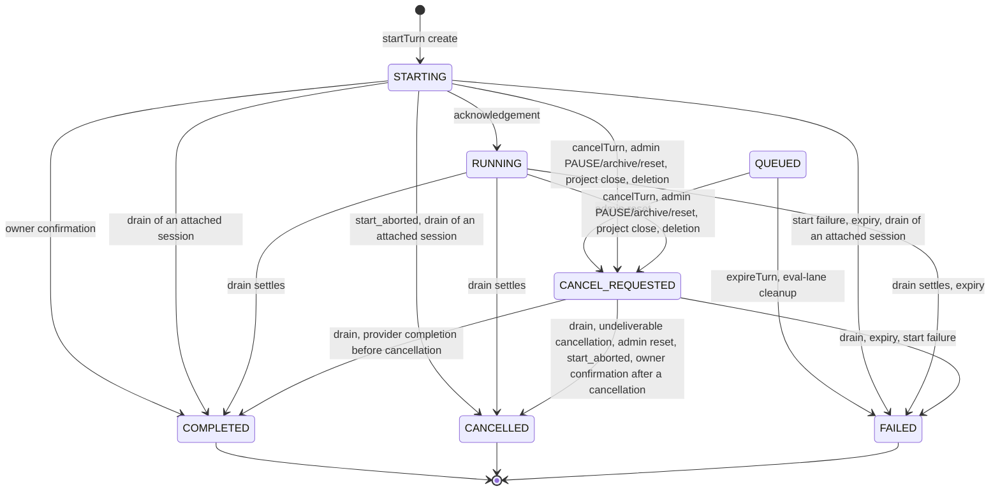

# Soko Bot turn lifecycle

How a `SokoBotTurn` row starts, who may drain it, how it recovers and how it ends. Turn lease renewal, recovery and the terminal checkpoint refer to the current code by function name. Paths are relative to `apps/core/src/`. Short names:

- **CP**: `services/soko-bot-control-plane.service.ts`
- **WD**: `services/soko-bot-turns-sync.service.ts` (the watchdog, run by `/sync/soko-bot-turns`)
- **AUTH**: `services/soko-bot-runtime/authorization.ts`

A claim marked **(unconfirmed)** could not be confirmed from the code.

## The row fields that carry ownership

| Field                     | Meaning                                                                                                                                                                                                                                                                                  |
| ------------------------- | ---------------------------------------------------------------------------------------------------------------------------------------------------------------------------------------------------------------------------------------------------------------------------------------- |
| `status`                  | Active: `QUEUED`, `STARTING`, `RUNNING`, `CANCEL_REQUESTED` (`ACTIVE_TURN_STATUSES`). Terminal: `COMPLETED`, `CANCELLED`, `FAILED`. Runtime authorization treats only `STARTING`, `RUNNING` and `CANCEL_REQUESTED` as active (`services/soko-bot-runtime/task-policy.ts`). |
| `leaseToken`              | The drain authority. Fenced writes compare it. `settleTurn` clears it; the eval-lane cleanup does not (see Exits that bypass `settleTurn`).                                                                                                                                    |
| `leaseExpiresAt`          | Runtime call authorization requires a future expiry. Renewal moves it forward. Settlement and explicit release clear it.                                                                                                                                                                 |
| `reconcilerHeartbeatAt`   | Liveness of the lease holder. The watchdog and duplicate recovery use it. Explicit release and an idle stored-event drain clear it. Settlement can leave the last beat on the terminal row.                                                                                              |
| `eveSessionId`            | The runtime session. Set by acknowledgement or by runtime session attach (AUTH).                                                                                                                                                                                |
| `errorKind`               | `runtime_start_ambiguous` marks a recovery in progress when the heartbeat is stamped, and a released start when the heartbeat is null.                                                                                                                                                   |
| `deadlineAt`              | Hard end, set once at creation: background run 6 h; otherwise 60 min if `personAsked \|\| input.personStarted`; otherwise 15 min.                                                                                                                                         |
| `eveStreamIndex`          | Drain cursor. The current drain moves it forward only (`advanceCursor`).                                                                                                                                                                                                   |
| `cancellationRequestedAt` | Set with `CANCEL_REQUESTED` by every writer listed under Cancellation, except that admin reset on a row already `CANCEL_REQUESTED` keeps the existing value.                                                                                                                             |
| `runnerDiagnosticAt`      | Claimed at most once by the sandbox failure report that fails the turn (`services/soko-bot-sandbox-turn.service.ts:772-780`).                                                                                                                                                            |

Constants: `TURN_LEASE_MS` 16 min (CP), `RECONCILER_HEARTBEAT_MS` 15 s (CP), `SOKO_BOT_TURN_STALE_HEARTBEAT_MS` 45 s (CP), watchdog `BATCH_SIZE` 20 candidates per scan (WD). The `/sync/soko-bot-turns` cron runs every minute (`apps/core/vercel.json`).

## States and transitions

Self-transitions are listed in the table, not drawn. The eval-lane cleanup marks every active status `FAILED` (see Exits that bypass `settleTurn`).

### `QUEUED`

The database column defaults to `QUEUED` (`packages/database/prisma/migrations/20260817190000_add_soko_bot_control_plane/migration.sql:110`; Prisma `@default(QUEUED)`). Core's only turn create passes `status: "STARTING"` explicitly (CP); no Core write of `QUEUED` was found.

A `QUEUED` row, legacy or defaulted, is active for Core:

- It can leave through `expireTurn` once due (scan 1, WD:85-96).
- Admin reset can fence it to `CANCEL_REQUESTED` (CP).
- The eval-lane cleanup can fail it.

Runtime authorization refuses it ("Soko Bot turn is not active", AUTH). `reconcileTurn` throws for it without a session (CP).

### Settlement (`settleTurn`)

Every terminal write except the eval-lane cleanup goes through `settleTurn`. It runs in a serializable transaction:

- **Re-read**: returns `false` if the row is no longer active, or if `input.leaseToken` is given and differs.
- **Billing**: bills from the row's totals. A billing shortfall replaces the error kind with `insufficient_credits`.
- **Cancellation vs. completion**: `COMPLETED` becomes `CANCELLED` when `cancellationRequestedAt` is set and the provider completion time is absent or at/after it. A `CANCEL_REQUESTED` turn therefore settles `COMPLETED` only when the recorded provider completion is strictly earlier than the cancellation.
- **Final CAS**: active status, plus `leaseToken` when given, plus `eveSessionId: null` when `requireMissingEveSession`. It clears `leaseToken` and `leaseExpiresAt`.

### Exits that bypass `settleTurn`

- `prepareEvalLane` (`services/evals/eval-lanes.service.ts:378-388`) updates every `QUEUED`/`STARTING`/`RUNNING`/`CANCEL_REQUESTED` turn of the lane's two bots to `FAILED` `eval_run_stopped`. There is no token check, and `leaseToken`, `leaseExpiresAt` and the heartbeat are left as they were.
- Hard bot deletion (`services/soko-bot-deletion.service.ts:168-176`) marks `STARTING`/`RUNNING` turns `CANCEL_REQUESTED`, then deletes every turn of the bot in the same transaction (`:111`).

### Transitions

| From                                                                                                                      | To                                                                      | Function                                                                                                                                                                                                                                                  | Lease condition                                                                                                                                                                             |
| ------------------------------------------------------------------------------------------------------------------------- | ----------------------------------------------------------------------- | --------------------------------------------------------------------------------------------------------------------------------------------------------------------------------------------------------------------------------------------------------- | ------------------------------------------------------------------------------------------------------------------------------------------------------------------------------------------- |
| none                                                                                                                      | `STARTING`, session null, heartbeat stamped                             | `startTurn` serializable create                                                                                                                                                                                                                           | New token. Heartbeat and lease are stamped with the database time sampled at reservation.                                                                                                   |
| `STARTING`                                                                                                                | `RUNNING`, session, heartbeat                                           | `startTurn` acknowledgement                                                                                                                                                                                                                | CAS `STARTING` + own token; writes heartbeat, not `leaseExpiresAt`                                                                                                                          |
| `STARTING`                                                                                                                | `RUNNING`, `errorKind` cleared                                          | `resumeAmbiguousStart` acknowledgement                                                                                                                                                                                                     | CAS `STARTING` + the token it was handed                                                                                                                                                    |
| `STARTING`/`RUNNING`, session null                                                                                        | same, session set                                                       | runtime `authorize` session attach (AUTH:127-176)                                                                                                                                                                                                         | no token compare; requires `deadlineAt` and `leaseExpiresAt` > now and an unpaused bot                                                                                                      |
| `STARTING`                                                                                                                | `STARTING`, `runtime_start_ambiguous`, heartbeat and expiry null        | `releaseStartLease` after an ambiguous start, retryable replay error or replay abort                                                                                                                                                                      | CAS `STARTING` + own token. The released start is immediately claimable.                                                                                                                    |
| Stale or released `STARTING`, session null or `runtime_start_ambiguous`                                                   | `STARTING`, new token, heartbeat, `runtime_start_ambiguous`             | `recoverStartingTurn` (watchdog and duplicate start)                                                                                                                                                                                                      | Bot eligibility and deadline checked under locks. CAS compares the observed lease, heartbeat and session.                                                                                   |
| `STARTING`/`CANCEL_REQUESTED`                                                                                             | Same, heartbeat and expiry refreshed                                    | `retainStartLease`, from acknowledgement error cleanup                                                                                                                                                                                                    | CAS own token with `startedAt: null`. The shared timer continues across cleanup.                                                                                                            |
| `STARTING` at the receipt; `STARTING`, or `CANCEL_REQUESTED` if a cancellation committed after the receipt, at settlement | `COMPLETED` requested; `CANCELLED` when settled from `CANCEL_REQUESTED` | `settleOwnerConfirmation`, from `startTurn` and `resumeAmbiguousStart`. The receipt transaction requires `STARTING`, own token and `cancellationRequestedAt: null` and commits before `settleTurn`. | `settleTurn` with own token and no provider time, so a row cancelled in between settles `CANCELLED`; a replaced token makes it return `false`, which is ignored |
| `STARTING`/`CANCEL_REQUESTED`                                                                                             | `FAILED` `runtime_start_failed`                                         | `failStartedTurn`, from `startTurn` and `recoverStartingTurn`                                                                                                                                                          | `settleTurn` with own token, any active status                                                                                                                                              |
| `STARTING`/`CANCEL_REQUESTED`                                                                                             | `CANCELLED` `start_aborted`                                             | `startTurn` catch after `SokoBotStartAbortedError`                                                                                                                                                                                         | `settleTurn` with own token                                                                                                                                                                 |
| `CANCEL_REQUESTED`                                                                                                        | same; accepted session, `start_aborted`, heartbeat null                 | `startTurn` catch when the accepted session was not reset                                                                                                                                                                                  | CAS `CANCEL_REQUESTED` + own token                                                                                                                                                          |
| `STARTING`/`RUNNING`                                                                                                      | `CANCEL_REQUESTED`                                                      | the cancellation writers below                                                                                                                                                                                                                            | none; token unchanged (admin reset excepted)                                                                                                                                                |
| any active foreground                                                                                                     | `CANCEL_REQUESTED`, new token, heartbeat and expiry                     | admin `RESET_SESSION` fence                                                                                                                                                                                                                               | CAS on observed status, session, token and heartbeat.                                                                                                                                       |
| `CANCEL_REQUESTED` (reset)                                                                                                | `CANCELLED` `session_reset`                                             | admin `RESET_SESSION`                                                                                                                                                                                                                                     | Settles under its new token. An active row after a missed settle leaves the intent pending and returns a conflict.                                                                          |
| `CANCEL_REQUESTED`, session null                                                                                          | `CANCELLED` `cancelled_before_runtime_start`                            | `settleUndeliverableCancellation`                                                                                                                                                                                                                         | Claims a fresh token under the turn lock if the heartbeat is stale or absent. Settlement also requires the session still be null.                                                           |
| active with a session (`STARTING` included)                                                                               | terminal                                                                | `reconcileTurn` on `input.requested`, `session.waiting`, `session.completed`/`session.failed`, or on one of them already persisted (terminal checkpoint, below)                                              | `settleTurn` with the drain's token                                                                                                                                                         |
| active                                                                                                                    | same; `runtime_stream_interrupted`; heartbeat now                       | `reconcileTurn` catch before the deadline                                                                                                                                                                                                  | CAS drain token + active; writes heartbeat only, not `leaseExpiresAt`                                                                                                                       |
| any active                                                                                                                | `FAILED` `turn_deadline_exceeded`                                       | `expireTurn`                                                                                                                                                                                                                                              | The drain supplies its own token. The watchdog, CMO and eval callers request expiry directly.                                                                                               |

`reconcileTurn` accepts `STARTING` rows with an attached session. An early attach leaves the start owner’s renewal timer running. The watchdog can claim the attached row after release or a stale heartbeat.

### Cancellation

Writers of `CANCEL_REQUESTED` + `cancellationRequestedAt`. None of them changes the token except admin reset, and admin reset on a row already `CANCEL_REQUESTED` keeps its `cancellationRequestedAt`.

| Writer                | Where                                               | Rows                                                                                                                                        |
| --------------------- | --------------------------------------------------- | ------------------------------------------------------------------------------------------------------------------------------------------- |
| `cancelTurn`          | CP                                                  | the turn, from `STARTING`/`RUNNING`                                                                                                         |
| admin `PAUSE`         | CP                                                  | the bot's newest active foreground turn, from `STARTING`/`RUNNING`                                                                          |
| `archive`             | CP                                                  | same                                                                                                                                        |
| admin `RESET_SESSION` | `applyAdminAction`                                  | The newest active foreground turn, any active status. Installs a new token and heartbeat, preserving an existing `cancellationRequestedAt`. |
| project close         | `services/project-soko-bots-close.service.ts:21-41` | every `STARTING`/`RUNNING` turn of the project's bots that are not archived or deleted                                                      |
| hard deletion         | `services/soko-bot-deletion.service.ts:168-176`     | every `STARTING`/`RUNNING` turn, deleted in the same transaction                                                                            |

Runtime cancellation is delivered only for a bound turn. `deliverRuntimeCancellation` needs both `eveSessionId` and `eveTurnId` (CP). `cancelTurn`, admin `PAUSE` and `archive` attempt it once. The drain redelivers it at its start and right after it binds the runtime turn, only while the row is still `CANCEL_REQUESTED`.

### `expireTurn` callers

- the watchdog's first scan (WD:85-96);
- `reconcileTurn` after a stream error past the deadline;
- a CMO turn with no runtime progress for 5 min (`services/soko-bot-turn-progress.service.ts`), which can expire before the deadline;
- a slow CMO research turn on re-hire (`services/cmo-hiring.service.ts:495-504`);
- CMO eval cleanup (`services/evals/eval-cmo-runner.ts`).

## Who holds the lease, and when it is renewed

| Holder                                    | Gets the token                                                                        | Renews                                                                                                                                                                                           |
| ----------------------------------------- | ------------------------------------------------------------------------------------- | ------------------------------------------------------------------------------------------------------------------------------------------------------------------------------------------------ |
| Fresh starter (`startTurn`)               | Commits the `STARTING` row with its first heartbeat                                   | `holdTurnLease` starts at commit and runs through runtime acceptance, early session attach, acknowledgement and cleanup. An acknowledged start hands its token to the caller for reconciliation. |
| Recovery claimant (`recoverStartingTurn`) | Wins the start claim, which stamps the first heartbeat                                | The same timer runs through context and memory reads, acknowledgement and cleanup. An ambiguous error or an aborted replay releases a still-owned `STARTING` row.                                |
| Drain (`reconcileTurn`)                   | Uses its start or recovery grant, its watchdog claim, or its runtime completion claim | Stamps at entry, on the same timer and on projected event writes. The timer stops when the drain ends or loses the lease.                                                                        |
| Watchdog stale claim                      | Wins the session-bound claim                                                          | The claim stamps the heartbeat. The drain starts immediately after claims are collected and renews through settlement.                                                                           |
| Admin reset                               | Installs a fresh token through the reset CAS                                          | Renews through runtime reset and settlement.                                                                                                                                                     |

Each timer tick uses one PostgreSQL statement to lock the turn, check its token, active status and heartbeat, then write the database time and a lease expiry 16 minutes later. A tick queued before settlement sees a cleared token. A tick queued before release sees a cleared heartbeat. A held lease is live until its stamp is 45 seconds old. Legacy unstamped starts use `createdAt`, while an explicit ambiguous-start release is immediately claimable.

Ticket 02 shipped the duplicate reader before ticket 03 enabled renewing writers and takeover. During a rolling deploy, a previous-version start with no heartbeat becomes claimable 45 seconds after `createdAt`. A previous-version start with a one-shot heartbeat becomes claimable 45 seconds after its last stamp. In either case the older invocation can still be blocked when a new worker claims the turn. The token fences its acknowledgement and settlement. Sandbox session creation remains non-idempotent per turn.

Runtime authorization is the only check that rejects on `leaseExpiresAt`. `authorize` (AUTH:31-241) also checks the feature switch and availability (AUTH:36-46), the requested capability and workspace access (AUTH). Its lifecycle checks:

1. Active status, without `CANCEL_REQUESTED` (AUTH).
2. An unpaused, unarchived bot (AUTH).
3. `deadlineAt` and `leaseExpiresAt` > now (AUTH).
4. Session: attach under bot and turn row locks with the same time checks (AUTH:111-207), else equality with the stored session (AUTH).

`requireMutationAuthority` (AUTH:260-399) runs inside the write transaction:

- An unapproved write re-checks the turn's status, deadline, lease and `cancellationRequestedAt: null` (AUTH:362-391).
- An approved write checks the bot and, when present, checks the confirmation turn's status, deadline, lease and cancellation flag after the confirmation, bot and intent row locks.

The watchdog reclaims on heartbeat age or an explicit release. Lease expiry controls runtime authorization and the live-start duplicate fence.

## Which clock each comparison uses

Every lease, heartbeat, deadline and cutoff time of a turn is PostgreSQL time. The timer calls `clock_timestamp()` inside its renewal statement. Other paths call it through `databaseNow` (`lib/db/database-now.ts`) and apply the thresholds in Core. `clock_timestamp()` reports the current time even after a lock wait. Host clock skew cannot decide who owns a turn (`services/soko-bot-lease-clock.postgres.test.ts`).

| Comparison                                                    | Where                                                 | Clock                                                                                                                                                                                                                                               |
| ------------------------------------------------------------- | ----------------------------------------------------- | --------------------------------------------------------------------------------------------------------------------------------------------------------------------------------------------------------------------------------------------------- |
| Deadline                                                      | `startTurn`                                           | PostgreSQL, sampled before context building.                                                                                                                                                                                                        |
| Created time, initial heartbeat and initial lease             | `startTurn` reservation                               | PostgreSQL, sampled under the bot lock. Setting `createdAt` explicitly avoids Prisma Client supplying the host clock.                                                                                                                               |
| Acknowledgement start time and heartbeat                      | `startTurn`, `resumeAmbiguousStart`                   | PostgreSQL, sampled once inside the acknowledgement transaction. A renewal CAS refreshes the heartbeat after a lost response.                                                                                                                       |
| Lease renewal                                                 | `holdTurnLease`, `renewTurnLease`, `retainStartLease` | PostgreSQL. The timer samples after taking the turn lock.                                                                                                                                                                                           |
| Stale cutoff                                                  | `staleTurnLeaseWhere`, `reconcileTurn` fence 2        | PostgreSQL against the stored heartbeat or legacy `createdAt`.                                                                                                                                                                                      |
| Watchdog scan cutoffs                                         | `syncActiveTurns`                                     | Expiry, abandoned-start and stale-drain scans each sample PostgreSQL. The sessionless cancellation claim checks staleness after locking the row.                                                                                                    |
| Recovery and stale claims                                     | `recoverStartingTurn`, `syncActiveTurns`              | PostgreSQL, sampled after locks. The same time checks deadline and staleness and stamps the winning claim.                                                                                                                                          |
| Runtime authorization                                         | `authorize`, `requireMutationAuthority`               | PostgreSQL. Mutation authorization uses one sample after the last row lock for intent expiry, turn deadlines and leases.                                                                                                                            |
| Replay deadline                                               | `resumeAmbiguousStart`                                | PostgreSQL before owner confirmation and again before runtime dispatch.                                                                                                                                                                             |
| Drain deadline after a stream error and heartbeat-only update | `reconcileTurn`                                       | PostgreSQL, one sample for both.                                                                                                                                                                                                                    |
| Completion vs cancellation in settlement                      | `settleTurn`                                          | Provider completion from the runtime event’s `meta.at` against the cancellation timestamp. Admin reset uses PostgreSQL time. Other cancellation writers use their host time.                                                                        |
| Sandbox runner budget                                         | `startSandboxTurn`, `soko-bot-runner/index.ts`        | Core subtracts PostgreSQL time from the stored deadline and sends the remaining budget in milliseconds. The runner uses that duration on its local clock. During rollout it falls back to the absolute deadline when older Core omits the duration. |
| Settled completion time                                       | `settleTurn`                                          | PostgreSQL for the stored `completedAt` used by readers.                                                                                                                                                                                            |

Readers outside CP, WD and AUTH that decide on a turn's times use PostgreSQL time too:

| Decision                                                                                                        | Where                                                                                                                                                                                                                                                                                                                                                             |
| --------------------------------------------------------------------------------------------------------------- | ----------------------------------------------------------------------------------------------------------------------------------------------------------------------------------------------------------------------------------------------------------------------------------------------------------------------------------------------------------------- |
| Sandbox turn token expiry (signed as `deadlineAt` + 60 s)                                                       | `routes/v1/soko-bot-runtime/index.ts` passes PostgreSQL time to `verifyTurnToken` (`lib/soko-bot/sandbox/turn-token.ts`)                                                                                                                                                                                                                                          |
| Sandbox VM timeout; in-process turn budget                                                                      | `lib/soko-bot/sandbox/sandbox-runtime.ts` (`launch`); `lib/soko-bot/in-process-runtime.ts` (`turnBudgetMs`), floors unchanged                                                                                                                                                                                                                                     |
| CMO stall (5 min without progress, then `expireTurn`)                                                           | `services/soko-bot-turn-progress.service.ts` compares PostgreSQL time with the last runtime event's receipt time, or the turn's creation time. `RuntimeEventLog` records receipts under its append lock.                                                                                                                                                          |
| CMO slow retry (twice the usual time)                                                                           | `services/cmo-hiring.service.ts` (`retryCmoOnboarding`)                                                                                                                                                                                                                                                                                                           |
| CMO eval lane: expire turns past their deadline; backdate earlier months' runs; a month case's production turns | `services/evals/eval-cmo-runner.ts` (`cusoIsBusy`, `startCmoCase`; `monthProductionTurns` selects by the approval's id prefix and the parent chain, not by time); `scripts/cmo-lab.mts` backdates the same way                                                                                                                                                    |
| Daily cap on self-started turns                                                                                 | `startTurn` and `proactiveGate` derive the local midnight cutoff from a PostgreSQL sample. The cutoff uses the start of the local date, including on offset-change days. `startTurn` samples under the bot lock and also uses that sample for the new turn's `createdAt`.                                                                                         |
| CMO production: runs in the last day (4 a day), "stuck"                                                         | `services/cmo-production.service.ts` (`readCmoProduction`)                                                                                                                                                                                                                                                                                                        |
| App-connected follow-up: recent turns that linked the app                                                       | `services/soko-bot-watches.service.ts` (`followUpConnectedApp`)                                                                                                                                                                                                                                                                                                   |
| Owner's Brand Brain fix vs the turn briefed on it                                                               | `services/brand-brain.service.ts`: `requestBrandBrainFix` stamps `fix.at` with PostgreSQL time inside its transaction, which `saveBrandBrain` compares with the writing turn's `createdAt` (`briefedAt`) and the fix turn's id carries as its `sent` mark. Open corrections stored before the deploy keep their host `fix.at` (see Mixed clocks after the switch) |
| Previous reply a bare "yes" may answer (12 h)                                                                   | `startTurn` (CP)                                                                                                                                                                                                                                                                                                                                                  |
| Tool smoke fixture                                                                                              | `scripts/soko-bot-tool-smoke.mts` writes `createdAt`, `deadlineAt` and `leaseExpiresAt` from one PostgreSQL sample                                                                                                                                                                                                                                                |

Other PostgreSQL clock readers:

- Eval case start and finish stamps, result elapsed-time checks, and the CMO month result's `createdAt >= context.startedAt` filter share PostgreSQL time. The month case's production-turn lookup also uses its approval id and parent chain.
- Three CMO eval checks compare the PostgreSQL case start with host-stamped `createdAt`. The report headline and competitor update read chat messages in `services/evals/eval-cmo-report-headline.ts:42` and `services/evals/eval-cmo-competitors.ts:344`. The styled-picture check reads image jobs in `services/evals/eval-cmo-runner.ts`.
- Mail triage's 24-hour published-post window and `latestExchange` in `lib/soko-bot/turn-model-context.ts` use a PostgreSQL cutoff. Meeting prep uses the invite evidence supplied in its message. The CMO activity feed selects reasoning by turn and session.
- Daily usage and quality, CMO spend, and the scheduled activity and dreaming context use PostgreSQL windows. `services/soko-bot-scheduled-beat.service.ts` keeps the scheduled slot for meeting prep. Chat Thought uses the stored start and completion, with PostgreSQL time for a legacy missing completion.

### Mixed clocks after the switch

Each effect is bounded by the skew between a host and PostgreSQL.

- **Concurrent writers.** While the previous release still serves requests during the deploy, it writes app-time leases, heartbeats and `createdAt` that this release compares with PostgreSQL time, and the reverse. This lasts as long as the overlap.
- **Decision error.** A comparison against such a value is off by that host’s skew and no more. A heartbeat can look fresher or staler, and a cutoff or deadline can pass early or late.
- **Legacy values.** After the last old writer stops, rows it created keep its `createdAt` and `deadlineAt` until they settle. The next renewal rewrites leases and heartbeats, within 15 s for a live drain. A deadline is set once, so a background run the old release created keeps the old writer's skew in its deadline for up to its whole 6 h window. Once such a row settles, its old values stay stored but no longer decide ownership.
- **Legacy Brand Brain corrections.** An open correction stored before the deploy keeps its host `fix.at` in the Brand Brain's JSON. It can stay open after its fix turn applied it only if its host was ahead by more than the gap between the correction and that fix turn. A follow-up can store each correction's identity and revision in the turn's brief metadata and decide completion and retry on that.
- **Intent expiry.** Discovery, classifier filtering, selection at reservation and runtime mutation authorization compare the stored `expiresAt` with PostgreSQL time. Intent creation stamps it from host time, so issuer clock skew can shift the effective lifetime. Inline owner confirmation and the pending-decision preflight still compare it with host time.

The CMO eval runner backdates `createdAt` by more than a day (`startCmoCase` in `services/evals/eval-cmo-runner.ts`) after `cusoIsBusy` found no active turn of the lane's Cuso. The update has no status filter, so a turn started on that bot in between would be backdated too, and the recovery scans could select it at once.

## Who may reconcile or drain a turn, and what fences it

### What `startTurn` returns

| Path                                                                                         | `duplicate`                                               | `reconciliationLeaseToken`          |
| -------------------------------------------------------------------------------------------- | --------------------------------------------------------- | ----------------------------------- |
| Fresh start commits its acknowledgement or proves it with a CAS                              | `false`                                                   | Its own token from the fresh start  |
| `recoverStartingTurn` wins the claim and commits its acknowledgement or proves it with a CAS | `true`                                                    | The token it installed in the claim |
| Duplicate observes an existing turn, including after a missed claim or a transaction race    | `true`                                                    | Absent                              |
| Acknowledgement rejects and both the proof and cleanup CAS miss                              | `true` if the row still exists                            | Absent                              |
| Owner-confirmation shortcut settles inline                                                   | Reflects whether the caller started or recovered the turn | Absent                              |

An active duplicate observation emits `soko_bot_turn_start` with `outcome: observed_duplicate` at info level. A released ambiguous start is immediately eligible for a claim. The client retry must win that claim before dispatching. A live holder keeps its lease when a duplicate arrives.

Runtime authorization can attach a session while the turn is still `STARTING`. A committed acknowledgement sets `startedAt` in the same transaction as `RUNNING`. If the acknowledgement call rejects, the starter first tries to renew the lease under its own token, with `startedAt` set, the accepted session ID and status `RUNNING` or `CANCEL_REQUESTED`. A CAS win returns the normal acknowledged start result and grant, including when cancellation arrived after commit. Otherwise, `retainStartLease` requires the starter's token and an unset `startedAt` before cleanup. If that CAS also misses, a re-read can describe the existing turn to the caller.

### Callers

| Caller                                                                   | Reconciles when                                                    | Token passed                   | Other rejection                                                                                                                                        |
| ------------------------------------------------------------------------ | ------------------------------------------------------------------ | ------------------------------ | ------------------------------------------------------------------------------------------------------------------------------------------------------ |
| `POST /v1/soko-bots/me/turns` and `POST /v1/soko-bots/{sokoBotId}/turns` | The start result grants a drain for a `STARTING` or `RUNNING` turn | The start result's grant       | Logs `Could not reconcile a new Soko Bot turn`                                                                                                         |
| Events sync                                                              | The start result grants a drain for a `STARTING` or `RUNNING` turn | The start result's grant       | Logs `Soko Bot event turn reconciliation failed`                                                                                                       |
| Schedules cron                                                           | The start result grants a drain and the run-link CAS succeeds      | The start result's grant       | Logs `Could not reconcile a scheduled Soko Bot turn`                                                                                                   |
| Chat mention dispatch                                                    | The start result grants a drain for a `STARTING` or `RUNNING` turn | The start result's grant       | `failSokoBotMention` fails the reply only if the turn holding it is `FAILED` or `CANCELLED`, or no turn holds it and this worker's stamp still matches |
| Taskboard and ingest                                                     | The start result grants a drain for a `STARTING` or `RUNNING` turn | The start result's grant       | Logs an error                                                                                                                                          |
| Watches, background runs, CMO production and task summary                | The start result grants a drain for a `STARTING` or `RUNNING` turn | The start result's grant       | Logs a warning                                                                                                                                         |
| Lab scenarios                                                            | The start result grants a drain                                    | The start result's grant       | Swallows the rejection                                                                                                                                 |
| Admin retry                                                              | The retry start returns a reconciliation grant                     | The retry start result’s grant | Logs an error                                                                                                                                          |
| Runtime `settleNow` from `closeTurn`                                     | It wins its session CAS with the launch token or a stale lease     | Its newly installed token      | Logs a warning                                                                                                                                         |
| Watchdog stale drain scan                                                | It wins the drain claim                                            | Its own claim's token          | Logs a warning                                                                                                                                         |
| Watchdog abandoned-start scan                                            | Recovery returns a reconciliation grant                            | The recovery result’s grant    | Logs a warning when recovery or reconciliation throws                                                                                                  |

`SokoBotReconciliationLeaseLostError` is the typed result of a lost drain fence. Callers record it at info level under `soko_bot_turn_reconcile` with `outcome: lease_lost` and stop draining. Every drain supplies the token from its own grant or claim. Admin operation replay can refresh diagnostics without obtaining a grant. Runtime completion presents the launch token that Core supplied at dispatch and installs a fresh drain token with a CAS on the active turn and its session. The sandbox receives the launch token as a signed proxy claim. The CAS accepts the launch token or a stale or released lease under the same rule as scan 4. Runtime completion can take over from a drain that still holds the launch grant. That drain stops at its next fenced write with `lease_lost`.

### Drain fences, in order

1. **Settled-and-cleared return.** A terminal row with a cleared token returns quietly.
2. **Token match.** An active row whose token differs throws `SokoBotReconciliationLeaseLostError` even while the successor is still starting its runtime session.
3. **Legacy live-first-start return.** A matching expected token can step back on a sessionless `STARTING` row with no error kind, a future lease expiry and a heartbeat (or legacy `createdAt`) younger than 45 seconds.
4. **Session and token required.** Missing either throws `Runtime turn not found`.
5. **Fenced projected-event writes.** Each projected event insert and its heartbeat write share a transaction. Zero heartbeat rows rolls back the insert and throws the typed loss. Usage is added from the locked row and the cursor moves forward only.
6. **Settlement CAS.** Settlement writes only under the token and an active status.

**Terminal checkpoint** (later than `0ebc62681`). After its first heartbeat and before streaming, a drain reads the row and the turn's persisted `turn.*` and settlement-trigger events (`input.requested`, `session.waiting`, `session.completed`, `session.failed`; `SETTLEMENT_TRIGGER_EVENT_TYPES`) in one repeatable-read snapshot (`persistedSettlement`). If a trigger is there, it settles from it the way the stream loop would (`settleOnTrigger`) and returns without streaming:

- The outcome is the last `turn.*` event before the trigger, read in the same snapshot as the trigger, so a drain under the same lease that commits `turn.failed` and `session.waiting` between this drain's first reads cannot make it settle `COMPLETED`.
- A failure's kind is the code its projected event stores (`runtime_failed` when it had none), not the row's `errorKind`, which a later `runtime_stream_interrupted` can overwrite. The row's `errorDetail` goes with it only while the row still carries that kind.
- The snapshot's token must be the drain's, or it throws `lease was lost`.
- A drain can settle a `CANCEL_REQUESTED` row from its persisted trigger. The normal cancellation ordering still applies. A live admin reset holds a separate fenced lease and settles `CANCELLED`/`session_reset` itself.
- Fence 6 keeps settlement and billing idempotent if a drain reaches settlement as its lease changes.

An exhausted AI Gateway key or team budget fails the turn with `ai_budget_exceeded`. Core uses shared Redis to alert once per exhausted scope per hour. When Redis cannot confirm a claim, Core allows one alert per scope per instance per hour. Repeats log at warn. Manage the limits with [`vercel ai-gateway budgets`](https://vercel.com/docs/cli/ai-gateway#budgets).

Core Gateway calls outside turns use the same classification and alert window. Calls that share a key also share its alert window, and a team budget shares one window across keys. Project memory skips a refused refresh with `ai_budget_exceeded` and releases its lock. If the weekly activity report is refused after the memory is saved, the prior report stays available.

Turn and tool-call error details stay available in admin diagnostics under the existing credential redaction. The scenario lab polls a single admin turn read scoped to the admin's own bot. Owner turn responses expose the error kind and return null for the detail. The nightly dream packet includes turn failure kinds and counts tool failures by capability and kind. Chat excerpts, stored previews and Jev's earlier-message and reply context use the same safe copy as new background failures.

### Start fences

- **Recovery claim CAS** (`recoverStartingTurn`): elects one worker per observed token, expiry, heartbeat and session. It locks the bot then the turn and samples PostgreSQL time after both locks. It skips a locked turn because foreground settlement can hold that turn and need the bot. A committed pause or archive makes the claim ineligible. A claim that wins writes the locked bot row so a serializable pause or archive with an older snapshot rechecks it.
- **Acknowledgement CAS** (CP): `STARTING` plus the token. A missed write throws `SokoBotStartAbortedError` inside the transaction. Cleanup must win its own fenced update.

### Runtime-side fences

These guard the `soko_bot_runtime_event` log the runtimes write. They take an advisory lock and compare no drain token.

- **`appendUnless`** (`lib/soko-bot/turn-loop.ts:117-168`) runs in one transaction:
  1. Takes the per-turn advisory lock.
  2. Skips the insert when the turn already holds one of the `recorded` event types.
  3. Calls `shouldAppend`. False skips the insert but commits the transaction, so `shouldAppend` must return false before it writes anything.
- **`failSandboxTurn`** (`services/soko-bot-sandbox-turn.service.ts`):
  1. Authorizes first, and announces the turn if no `turn.started` exists.
  2. Appends `turn.failed` unless `turn.completed`/`turn.failed` exists. It deliberately does not dedupe on `turn.cancelled`.
  3. Under the append lock, re-checks only `STARTING`/`RUNNING` and `cancellationRequestedAt: null` (`live`), not session or expiry.
  4. With a diagnostic, the same transaction stamps `runnerDiagnosticAt` where it is null. The log line follows the commit, at most once. If that transaction throws, it retries the failure append without the claim.

## The watchdog's scans and the windows between them

`syncActiveTurns` exits when `SOKO_BOT_ENABLED` is off or `shouldContinue()` is false. It checks `shouldContinue()` before each later scan and each claim. Evaluation can limit the scans to its own bots. Each scan selects up to 20 candidates.

1. **Expiry.** Active and `deadlineAt <= now`, oldest deadline first. Calls `expireTurn`.
2. **Undeliverable cancellation.** `CANCEL_REQUESTED` with no session. Calls `settleUndeliverableCancellation`. It claims a fresh lease when the old heartbeat is stale or absent.
3. **Abandoned start.** Sessionless `STARTING`, deadline in the future and heartbeat at least 45 s old, legacy unstamped and created at least 45 s ago, or explicitly released. Before ordering and limiting the candidates, it excludes archived, admin-paused and `PAUSED` bots, and unprompted work when proactive work is paused locally or globally. Each recovery checks eligibility again under the bot lock. Recoveries run in parallel and finish before scan 4.
4. **Stale drain.** Active with a session and a future deadline. Applies the same 45 s rule to stamped rows and legacy unstamped starts. An attached released start or an unstamped non-start is eligible immediately. The claim rechecks the observed token, session and heartbeat and the current deadline under the turn lock. Winners drain in parallel.

The watchdog drains each grant from scan 3 in the same tick. A later scan 4 can reclaim it if its heartbeat goes stale or the drain releases it. When the sandbox or in-process drain exhausts its stored-event snapshot, it checks for a newly appended terminal marker under the same turn lock that runtime completion uses. If it sees the marker, it drains the remaining events with its own token. Otherwise it clears its heartbeat and leaves the lease expiry available for runtime authorization. A later close can claim the released lease immediately. Previews rely on `settleNow` for runtime completion and run no watchdog cron or claim-on-read recovery. If the preview process dies before settling, the turn can stay open.

A drain that crashes, is aborted or hits a stream error before this check keeps its heartbeat; close then loses, and the turn settles on the first watchdog tick after the heartbeat is 45 s stale (about 45-105 s).

A duplicate retries a released start through the same claim as the watchdog. A duplicate with a live holder cannot replay the start. There is still a window between the final deadline check and dispatch. Runtime authorization enforces the deadline for runtime calls.

## Known gaps

G11 (every lease, heartbeat and deadline time used the application clock) is closed for ownership. Every lease, heartbeat and cutoff that decides who owns, drains or authorizes a turn uses PostgreSQL time, switched in one release. Old releases can leave host-stamped runtime event receipts, turn starts and completions, and eval case starts. Those timestamps stay stored and can affect recent progress, recency or duration until they age out of the applicable window.

Sandbox session creation can dispatch twice if a worker loses its lease after sending the request. The acknowledgement and drain fences protect the turn row and its settlement.

During a rolling deploy, runtime credentials issued before ticket 05 can lack the launch token needed for immediate settlement on a new Core process. The production watchdog can drain those turns after the heartbeat goes stale. Old Core invocations can still use their previous drain logic until the deploy overlap ends (G10). The post-#7409 writer keeps usage updates and the cursor monotonic during that overlap.
